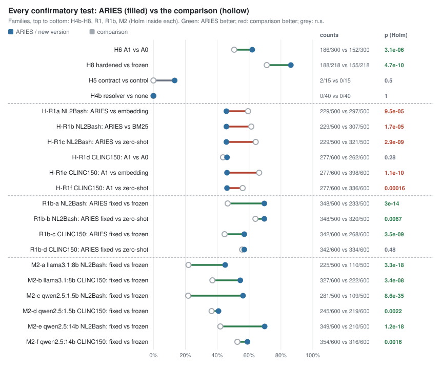
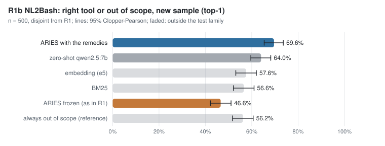
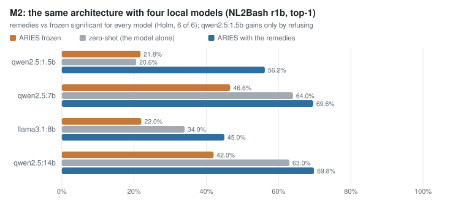
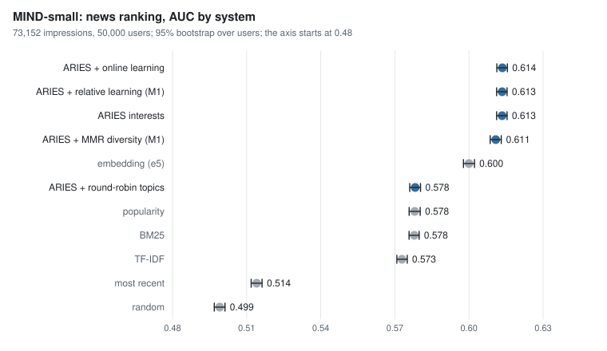
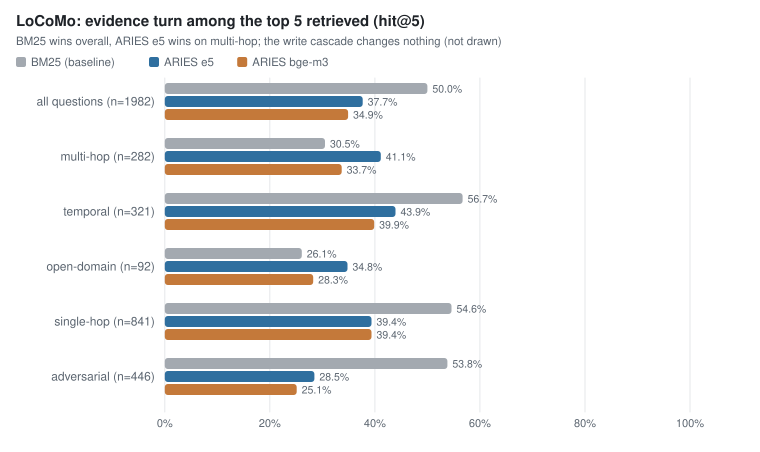
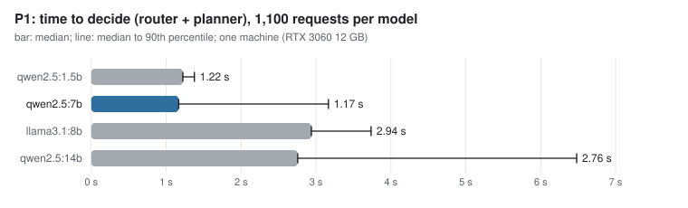
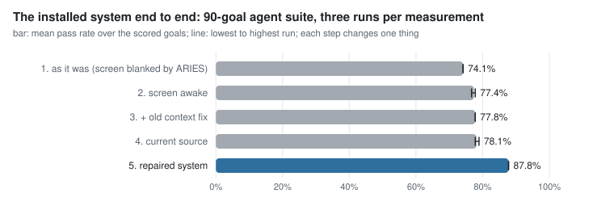
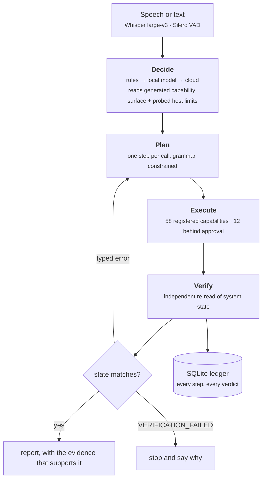
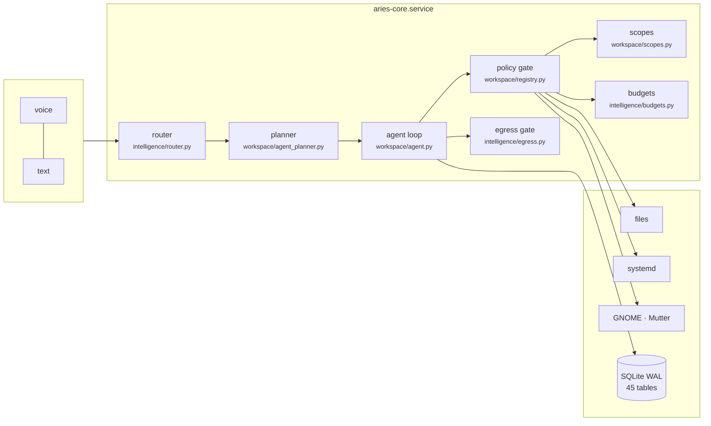

# ARIES

A voice-driven assistant that acts on a live Ubuntu/GNOME desktop, built around one question:

> **What may an agent claim about itself?**

An agent that acts on a real machine makes two claims — *"I can do this"* before acting, and
*"I did this"* after acting. This project grounds both in machine-readable facts rather than in
the model's own confidence or the executor's own report, and measures what that is worth.

Everything below carries its denominator. Where a number is missing, that is said rather than
filled in.

> **Reviewing this repository?** Start with the **[reviewer guide](docs/REVIEWER_GUIDE.md)**
> (Macedonian summary and English). It lists every research question with its result and its
> evidence, maps the code by component, and shows how to recompute the thesis tables (`make check`).
>
> | | |
> |---|---|
> | Thesis results, all in one place | [`experiments/thesis-followup-20261012/RESULTS.md`](experiments/thesis-followup-20261012/RESULTS.md) |
> | **Every comparison as a figure** | [`experiments/analysis/README.md`](experiments/analysis/README.md) |
> | IIS results on public data | [`experiments/iis/real-data/README.md`](experiments/iis/real-data/README.md) |
> | Preregistered hypotheses | [`docs/preregistration/`](docs/preregistration/) |
> | Every document | [`docs/INDEX.md`](docs/INDEX.md) |
>
> **Branches.** `main` is the whole project. [`diplomska`](https://github.com/stamenovmartin/aries/tree/diplomska) and [`iis`](https://github.com/stamenovmartin/aries/tree/iis) hold the
> same code, each with a front page that leads straight to that project's results.

## Evaluation on public datasets

Each component is evaluated on a public dataset, not only on the author's own fixtures. The datasets are not in this
repository (their licences); `download.sh` in each folder fetches them, and the **sample manifests (item ids), the
labels and every result are committed**, so each number can be recomputed.

| Component | Dataset (source) | What it measures | Sample | Labels |
|---|---|---|---|---|
| Tool selection (router + planner: which of 58 capabilities, or refuse) | [NL2Bash](https://github.com/TellinaTool/nl2bash) (Lin et al., 2018) | right capability, or refusal when no capability fulfils the request | 500 (R1) + 500 new (R1b) | two LLM annotators + adjudication, κ 0.649 / 0.733 ([`labels/`](experiments/thesis-r1-real-data/labels/)) |
| Act or refuse (router) | [CLINC150](https://github.com/clinc/oos-eval) (Larson et al., 2019) | out-of-scope detection | 600 (R1) + 600 new (R1b) | the dataset's out-of-scope class; intents mapped to capabilities, κ 0.826 |
| The same with four local models | the R1b samples | does the result depend on the model? | 4 models × 1,100 | as above |
| Verifiers | 218 injected faults (sealed manifest) | does the check catch an executor that lies? | 218 mutants | by construction |
| Semantic memory | [LoCoMo](https://github.com/snap-research/locomo) (Maharana et al., 2024) | are the annotated evidence turns retrieved in the top 5? | 10 conversations, 1,982 questions | the dataset's evidence annotations |
| News ranking and learning | [MIND-small](https://msnews.github.io/) (Wu et al., 2020) | ranking clicked over skipped news | 73,152 impressions, 50,000 users | the dataset's clicks |

| Result | Status | Numbers | Evidence |
|---|---|---|---|
| R1: the frozen ARIES on NL2Bash | confirmatory | **ARIES lost**: 229/500 vs zero-shot 321/500, BM25 307/500, embedding 297/500 | [`thesis-r1-real-data/`](experiments/thesis-r1-real-data/) |
| R1b: after diagnosis and repair, on new samples | confirmatory | NL2Bash **348/500** vs frozen 233/500 and zero-shot 320/500; CLINC150 342/600 vs 268/600 (vs zero-shot 334/600, n.s.) | [`thesis-r1b/summary.json`](experiments/thesis-r1b/summary.json) |
| M2: four local models (qwen2.5 1.5B/7B/14B, llama3.1:8b) | confirmatory | repaired > frozen for every model, both datasets, 6/6 after Holm; the 1.5B model wins only by refusing everything | [`thesis-m2-models/summary.json`](experiments/thesis-m2-models/summary.json) |
| H8: verifier strength | confirmatory | hardened verifiers catch 188/218 faults vs 155/218 | [`h8/`](experiments/thesis-followup-20261012/h8/) |
| Memory on LoCoMo | exploratory | hit@5 0.377 (original) → **0.620** (hybrid + similarity rank) vs BM25 0.500 | [`iis/real-data/locomo/`](experiments/iis/real-data/locomo/) |
| News on MIND-small | exploratory | AUC 0.613, above all 7 baselines (best 0.600); online learning adds nothing | [`iis/real-data/mind/`](experiments/iis/real-data/mind/) |

**Where each result is in this repository.** The component's code, the script that ran the measurement, the
script that computed the numbers, and the file the numbers are read from:

| Result | Component code | Run | Analysis | Numbers |
|---|---|---|---|---|
| R1 | [`router.py`](aries/intelligence/router.py), [`agent_planner.py`](aries/workspace/agent_planner.py) (frozen source) | [`run_r1.py`](experiments/thesis-r1-real-data/run_r1.py) | [`analyze_r1.py`](experiments/thesis-r1-real-data/analyze_r1.py) | [`summary.json`](experiments/thesis-r1-real-data/summary.json), per-item [`predictions.json`](experiments/thesis-r1-real-data/predictions.json) |
| R1b | the above + [`capability_gate.py`](aries/intelligence/capability_gate.py) | [`run_r1b.py`](experiments/thesis-r1b/run_r1b.py) | [`analyze_r1b.py`](experiments/thesis-r1b/analyze_r1b.py) | [`summary.json`](experiments/thesis-r1b/summary.json) |
| M2 | same as R1b | [`run_m2.py`](experiments/thesis-m2-models/run_m2.py) | [`analyze_m2.py`](experiments/thesis-m2-models/analyze_m2.py) | [`summary.json`](experiments/thesis-m2-models/summary.json) |
| P1 | the same pipeline; the installed service | [`run-p1.sh`](experiments/thesis-p1-performance/run-p1.sh), [`sample.py`](experiments/thesis-p1-performance/sample.py) | [`analyze_p1.py`](experiments/thesis-p1-performance/analyze_p1.py), [`diagnose_p1.py`](experiments/thesis-p1-performance/diagnose_p1.py) | [`summary.json`](experiments/thesis-p1-performance/summary.json), [`diagnosis.json`](experiments/thesis-p1-performance/diagnosis.json) |
| H8 | [`verification/`](verification/) | [`run_mutants.py`](experiments/thesis-followup-20261012/h8/run_mutants.py) | [`analyze.py`](experiments/thesis-followup-20261012/h8/analyze.py) | [`h8/RESULTS.md`](experiments/thesis-followup-20261012/h8/RESULTS.md), [`runs/`](experiments/thesis-followup-20261012/h8/runs/) |
| Hallucinations (HAL1) | [`agent.py`](aries/workspace/agent.py), [`contracts.py`](aries/workspace/contracts.py) | the runs above | [`hallucination_eval.py`](experiments/thesis-improvements-20261022/hallucination_eval.py) | [`hallucination-summary.json`](experiments/thesis-improvements-20261022/hallucination-summary.json) |
| LoCoMo | [`retrieval.py`](aries/workspace/retrieval.py), [`memory/`](aries/workspace/memory/) | [`locomo_eval.py`](experiments/iis/real-data/locomo/locomo_eval.py) | the same script | [`results/`](experiments/iis/real-data/locomo/results/): first run `…T072458Z`, embeddings `…T142603Z`, M1 `…T193500Z` and `…T200243Z` |
| MIND-small | [`interests/`](aries/interests/), [`selection.py`](aries/news/selection.py), [`loop.py`](aries/learning/loop.py) | [`mind_eval.py`](experiments/iis/real-data/mind/mind_eval.py) | the same script | [`results/`](experiments/iis/real-data/mind/results/): first run `…T072250Z`, embedding baseline `…T142633Z`, M1 `…T193501Z` |

Each run writes a new file and never overwrites one. The runs record the source commit or code hash, and, where a
model is used, its digest. Every ratio in the thesis is checked against these files when the thesis is built.

<p align="center"></p>

| | |
|---|---|
|  |  |
|  |  |
|  |  |

Every figure is drawn from the result files by [`make_figures.py`](experiments/analysis/make_figures.py) and
checked in CI; the explanations are in [`experiments/analysis/README.md`](experiments/analysis/README.md).

The first public-data result (R1) was negative and stays reported; the repairs were designed from its records,
registered before the new measurement (R1b), and checked with four models (M2). All results in one place:
[`experiments/thesis-improvements-20261022/RESULTS.md`](experiments/thesis-improvements-20261022/RESULTS.md).

## Evaluation map

Status labels: **confirmatory** = preregistered hypothesis, measured as registered (Holm family H4b/H5/H6/H8 for
the follow-up); **exploratory** = analysis or run not preregistered as a hypothesis test; **descriptive** = counts
on a fixture, no test; **pilot** = run on example items only, not scored; **registered, not run** = the
preregistration exists and no measurement does. Full follow-up results: [`experiments/thesis-followup-20261012/RESULTS.md`](experiments/thesis-followup-20261012/RESULTS.md).

### Thesis: the agent (router, planner, executor, verifiers, completion, clarification)

| What is measured | Dataset | Size | Status | Results |
|---|---|---|---|---|
| Router: what grounds the decision to act or abstain (arms A0–A3), qwen2.5:7b | out-of-distribution utterances (author-written) | 225 utterances × 4 arms × 3 reps = 2,700 decisions | confirmatory (predeclared criterion **not met**) | [`experiments/thesis-final-20261006/`](experiments/thesis-final-20261006/) |
| Router: paired statistics on the same decisions | same | 225 | exploratory (post hoc) | [`experiments/thesis-followup-20261012/stats.md`](experiments/thesis-followup-20261012/stats.md) |
| Router: second model, llama3.1:8b | same | 2,700 decisions | exploratory | [`experiments/thesis-followup-20261012/task6-model/`](experiments/thesis-followup-20261012/task6-model/) |
| H6: abstention instruction (A1 vs A0) on new requests, qwen2.5:7b | new requests, written by an LLM in a separate session | 300 × 2 arms × 3 | confirmatory (primary criterion met) | [`experiments/thesis-followup-20261012/h6-run/`](experiments/thesis-followup-20261012/h6-run/) |
| H6 secondary: the same with llama3.1:8b | same | 300 × 2 × 3 | exploratory, outside Holm | [`experiments/thesis-followup-20261012/h6-llama/`](experiments/thesis-followup-20261012/h6-llama/) |
| Verifier classes (independent, self-report, trivial, planner-supplied) | all registered capabilities; frozen ledger | 58 verifiers; 8,032 goals, 8,285 steps | descriptive | [`verification/`](verification/), [`experiments/thesis-followup-20261012/verifier-count.md`](experiments/thesis-followup-20261012/verifier-count.md) |
| H8: verifier strength by fault injection, hardened vs baseline | mutant manifest (sealed hash) | 218 mutants | confirmatory (criteria 1 and 3 met, 2 not met) | [`experiments/thesis-followup-20261012/h8/`](experiments/thesis-followup-20261012/h8/) |
| End to end on the author's fixture | `eval/agent_suite/fixture.jsonl` | 90 goals, 1 run | descriptive | [`eval/agent_suite/`](eval/agent_suite/) |
| End to end on a held-out fixture | 57 scenarios generated by an LLM in a separate session | 49 run | descriptive | [`experiments/product/independent-acceptance/`](experiments/product/independent-acceptance/) |
| Why no held-out goal reached `done` | same | 49 goals | exploratory (diagnosis) | [`docs/analysis/terminal-state-diagnosis.md`](docs/analysis/terminal-state-diagnosis.md) |
| Planner regression with clarification flags | planner fixture | 72 cases | regression check | [`experiments/thesis-followup-20261012/task3-summary.json`](experiments/thesis-followup-20261012/task3-summary.json) |
| H4: planner asks on new ambiguous goals | external sets A and C | — | registered, not run (sets not received) | [`docs/preregistration/H4-planner-clarification.md`](docs/preregistration/H4-planner-clarification.md) |
| H4b: clarification resolver (ask vs select among candidates) | ambiguous/twin pairs, written by an LLM in a separate session | 40 pairs (80 items) × 2 conditions × 3 | confirmatory (**not met**: pairs correct 0/40 with and without the resolver) | [`experiments/thesis-followup-20261012/h4b-runs/`](experiments/thesis-followup-20261012/h4b-runs/) |
| H5: typed completion contract | 25 new items + 49 held-out goals | 74 items × 2 conditions × 3 | confirmatory (**not met**: 2/15 vs 0/15, p = 0.25) | [`experiments/thesis-followup-20261012/h5-runs/`](experiments/thesis-followup-20261012/h5-runs/) |
| R1: tool selection on NL2Bash; out-of-scope detection on CLINC150 | public datasets, LLM-labelled (κ 0.65 / 0.83) | 500 / 600 sampled | confirmatory (R1 family): **zero-shot, BM25 and embedding baselines beat ARIES** | [`experiments/thesis-r1-real-data/`](experiments/thesis-r1-real-data/), RESULTS §13 |
| R1b: the R1 remedies (capability gate, consistent surface, per-capability grammar) on new samples | public datasets, new disjoint samples, LLM-labelled (κ 0.733) | 500 / 600 | confirmatory (R1b family, 3 of 4 tests significant): **NL2Bash 348/500 vs frozen 233/500 and zero-shot 320/500; CLINC150 342/600 vs frozen 268/600, vs zero-shot 334/600 n.s.**; weaker in scope (92/219 vs 120/219) | [`experiments/thesis-r1b/`](experiments/thesis-r1b/), [prereg](docs/preregistration/R1b-improved-router-planner.md) |
| M2: the R1b systems with three more local models (llama3.1:8b, qwen2.5:1.5b, qwen2.5:14b) | the R1b samples | 500 / 600 per model | confirmatory (M2 family, **6 of 6 tests significant**, T vs frozen): NL2Bash llama 225 vs 110, 1.5b 281 vs 109, 14b 349 vs 210 (/500); CLINC150 327 vs 222, 245 vs 219, 354 vs 316 (/600); 1.5b reaches its NL2Bash score by refusing everything (in scope 0/219) | [`experiments/thesis-m2-models/`](experiments/thesis-m2-models/), [prereg](docs/preregistration/M2-local-models.md) |
| P1: latency, resources and reliability | the R1b samples (decision); the 90-goal agent suite on the installed system, three runs | 1,100 decisions per model; 3 × 90 goals | descriptive: decision median 1.2 s (7b) to 2.8 s (14b), p90 up to 6.5 s; VRAM 1.7-10.0 GB; **installed system 63/85 in every run, 89/90 goals with the same outcome**, down from 88/90 on 2026-10-04; ARIES's own Background Mode was blanking the screen (8 goals); with the screen awake 69-70/90 (C2), unchanged with ARIES_PLAN_DISPATCH_FIX (C3); the remaining 9 context-budget and 7 invalid-output failures are reproduced, with the remedies (`ARIES_PLAN_CONTEXT_FIT`, `ARIES_PLANNER_PER_CAP_GRAMMAR`) the repaired live system passes **79/90 in each of three runs**; they stay on | [`experiments/thesis-p1-performance/`](experiments/thesis-p1-performance/), [prereg](docs/preregistration/P1-performance.md) |
| X1: H5 and H4b re-run with the remedies | the H5 and H4b items (already seen) | 3 runs per condition | exploratory: H4b code-select 32/40 pairs (was 0/40); H5 correct done 12/45 (was 6/45) but false done 15/75 (was 12/75) | [`experiments/thesis-improvements-20261022/`](experiments/thesis-improvements-20261022/) |
| HAL1: what the model invents vs what the system lets through | all H5, H4b, X1, R1, R1b runs | — | descriptive: no invented evidence (0/50, 0/26, 0/8); invalid planner output 126/449 → 2/208; final texts with model prose 0 | [`hallucination-summary.json`](experiments/thesis-improvements-20261022/hallucination-summary.json), [prereg](docs/preregistration/HAL1-hallucination-measures.md) |
| One row per component (router, planner, verifiers, completion, clarification, end to end) | the rows above | — | summary | [`experiments/thesis-followup-20261012/thesis-tables/components.csv`](experiments/thesis-followup-20261012/thesis-tables/components.csv) |

### IIS project: the information layer (interests and news, learning, semantic memory)

| What is measured | Dataset | Size | Status | Results |
|---|---|---|---|---|
| Semantic memory: extract-then-store vs store-everything, e5-base | author-written corpus and probes | 45 rows, 25 probes | preregistered hypothesis (supported on clean@3, not on hit@3) | [`experiments/iis/memory/analysis.md`](experiments/iis/memory/analysis.md) |
| Semantic memory: embedder swapped to bge-m3 | same | 45 rows, 25 probes | exploratory | [`experiments/iis/memory/summary-bge-m3.json`](experiments/iis/memory/summary-bge-m3.json) |
| Learning: task-experience retrieval, `focused-v2` vs `overlap-v1` | developer-labelled queries (regression fixture) | 20 queries | descriptive | [`docs/LEARNING_COMPARISON.md`](docs/LEARNING_COMPARISON.md) |
| Interests: news preference relevance checks | explicit user preferences | 3 interests, 3 checks | descriptive | [`experiments/iis/interests/`](experiments/iis/interests/) |
| News ranking on MIND-small: ARIES interest profile vs 7 baselines, plus online learning | public dataset (Microsoft) | 73,152 impressions, 50,000 users | exploratory: **ARIES beats every baseline** (AUC 0.613; best baseline, embedding, 0.600); learning adds +0.0001; MMR diversity (M1) 0.611 vs round-robin 0.578 | [`experiments/iis/real-data/mind/`](experiments/iis/real-data/mind/) |
| Memory retrieval on LoCoMo: annotated evidence turns in the top 5 | public dataset (Snap Research) | 10 conversations, 1,982 questions | exploratory: BM25 beat the original ARIES memory (hit@5 0.500 vs 0.377); with `ARIES_MEMORY_HYBRID_RRF` + `ARIES_MEMORY_SIMILARITY_RANK` (M1) **0.620**, +0.120 [0.098, 0.147] over BM25 | [`experiments/iis/real-data/locomo/`](experiments/iis/real-data/locomo/) |

---

## What it does

Speech or text in, real action out: files, systemd units, windows and workspaces, media sinks,
read-only network state, synthesised keyboard and pointer input. Local-first — a local LLM
decides and plans; a cloud provider is opt-in and gated.

It is not a chat model with tools attached. Three properties exist specifically to make it
measurable:

**A closed capability registry.** 58 capabilities, each declaring an argument schema, an
executor, a verifier and an effect class. A model cannot act outside that set, and the refusal
is an observable event rather than an inference.

**Verification as a separate stage.** After a step runs, state is re-read through a path that
does not go through the executor. For a service restart the executor calls `systemctl` and reads
its exit status; the verifier compares the unit's `InvocationID` before and after. A call that
exits zero without restarting anything does not change it.

**Typed errors that decide what happens next.** `TARGET_NOT_FOUND` and `CAPABILITY_UNAVAILABLE`
route to a declared alternative; `VERIFICATION_FAILED` stops. Budgets are hard: at most 4
capability invocations per sub-goal, 2 repeats of one strategy, 2 distinct alternatives.



---

## Results

### The main experiment: what grounds the decision to act (controlled evaluation)

**ARIES-FINAL-20261006.** 225 out-of-distribution utterances (100 actionable, 40 out-of-scope), four additive
prompt arms, **3 repetitions each = 2,700 router decisions**. Same model (`qwen2.5:7b`, digest `845dbda0…`),
same rules and frozen source in every arm; the protocol was fixed before the run (sha256 `1dc4d61e…`).
Pooled counts combine three observations per utterance, so the independent sample size remains 225.

| arm | correct act/hold | out-of-scope refused | refusal precision | real requests wrongly refused |
|---|---|---|---|---|
| A0 baseline, no refusal vocabulary | 385/675 (57.0%) | 0/120 | never refuses | 15/300 |
| A1 + `ASK` / `OUT_OF_SCOPE` | **463/675 (68.6%)** | 46/120 | 139/160 | 48/300 |
| A2 + generated capability surface | 440/675 (65.2%) | 33/120 | 72/73 | 18/300 |
| A3 + probed machine limits | **463/675 (68.6%)** | 29/120 | 90/93 | 21/300 |

**The predeclared criterion was not met.** A3 − A1 = 0.0 percentage points (descriptive paired case-bootstrap
95% interval −5.6 to +6.1 pp). Per utterance, 26 improved, 25 got worse and 174 stayed equal. Of the three
predeclared conditions, only native-semantic non-inferiority held; binary accuracy did not improve and false
action on out-of-scope requests did not decrease. A paired re-analysis on per-utterance majorities confirms it:
exact McNemar A3 vs A1 p = 1.0, while A1 vs A0 p = 0.00035
([`experiments/thesis-followup-20261012/stats.md`](experiments/thesis-followup-20261012/stats.md)).

What grounding (A2, A3) did change is the **kind** of refusal: refusal precision rises from 139/160 (A1) to
90/93 (A3), and real requests wrongly refused fall from 48/300 to 21/300. But out-of-scope requests refused
also fall, from 46/120 to 29/120. This is a precision–recall trade-off, not a better signal on both axes.

Sources: `dokazi/final-evaluation.json` in the thesis package (raw data
`experiments/thesis-final-20261006/raw/`, 12 files, sha256s listed there).

### Historical / pilot: single-run series (superseded by the controlled evaluation above)

Before the controlled evaluation, the same four arms were run **once each** (225 decisions per arm) from a
snapshot at `2026-10-06T12:38Z`, commit `f9b500d`, with confidence threshold 0.82. These are pilot figures;
they were not repeated and they did not survive repetition with the same ordering.

| arm | accuracy | out-of-scope refused | refusal precision | real requests wrongly refused |
|---|---|---|---|---|
| A0 baseline, no refusal vocabulary | 119/225 | 0/40 | never refuses | 0/100 |
| A1 + `ASK` / `OUT_OF_SCOPE` | 153/225 | 15/40 | 44/53 | 9/100 |
| A2 + generated capability surface | 157/225 | 17/40 | 38/40 | 2/100 |
| A3 + probed machine limits | 161/225 | 21/40 | 47/48 | 1/100 |

In this single run, A3 looked best on every column, and the interpretation offered at the time was that
grounding raised precision *and* refused more out-of-scope requests. The controlled evaluation did not
reproduce that: out-of-scope refusal was highest in A1.

Context that applies to both series:

- **47/48 (pilot) and 90/93 (controlled) are refusal precision**, not system accuracy.
- A trivial system that refuses everything scores **125/225** per run. Every accuracy figure must be read
  against that.
- Model confidence alone separated the two populations at **AUC 0.725** on the English fixture (earlier analysis; not recomputed in the controlled evaluation).
  Without refusal words in the intent vocabulary the router refused **0 of 229** utterances, not from
  certainty but from having no way to say no.

### What "verified" actually means

From the frozen snapshot `2026-10-06T12:38Z`, commit `f9b500d`; extracted from raw artifacts by script.

All 58 verifiers were classified, 57 of them with executed proof.

| class | n | what it does |
|---|---|---|
| independent | **35** | re-reads state through a path the executor does not control |
| self-report | 10 | restates the executor's own return value |
| trivial | 12 | returns "met" with no comparison at all |
| planner-supplied | 1 | compares against a value the planner chose |

Joined against the full ledger (8,032 goals, 8,285 steps):

| | |
|---|---|
| steps that reached a verifier | 1,010 / 8,285 = 12.2% |
| contradictions | **2 / 1,010 = 0.20%**, Wilson 95% [0.05%, 0.72%] |
| by trivial verifiers | 0 / 84 — **by construction, not by observation** |

The published coverage figure this project previously quoted (85.3%, 0 contradictions) was
computed over the newest 500 of 8,032 goals — **6.2% of the work, reported as the whole**. The
same query returned 85.3% one day and 76.9% two days later. That is corrected above and the
disclosure flag has since been added to the metric.

### End-to-end, on the author's own fixture

| category | n | pass | false success |
|---|---|---|---|
| single step | 20 | 20 | 0 |
| multi-step | 25 | 25 | 0 |
| ambiguous | 15 | 15 | 0 |
| fault-injected | 15 | 15 | 0 |
| refuse or approve | 10 | 9 | 1 |
| out of scope | 5 | 4 | 1 |
| **total** | **90** | **88** | **2** |

One run per goal, one machine, fixture written by the system's author. Both false successes are
reported rather than reclassified.

### End-to-end, on a held-out fixture the author did not write

57 scenarios authored independently, never seen during development; 49 run (8 need a service
restart and were not).

| | |
|---|---|
| pass | 29 |
| fail | 16 |
| inconclusive — the check itself could not answer | 4 |
| **goals that reached `done` or `answered`** | **0** |

25 ended `partial`, 21 `failed`, 3 `proposed`. That last row is the real finding: **the system
does the work and does not recognise that it finished.** In the smoke case it read the requested
file, the read was independently verified, and then it proposed the same read seven more times
until the budget ran out.

The 16 failures were triaged one by one:

| | n | |
|---|---|---|
| fixture defects | 5 | inverted checks (`grep -c` and `pgrep -c` exit 1 on zero matches, so the correct state fails), a check not isolated from the background scheduler, and `proposed` missing from an accepted-terminal-state list |
| system defects | 7 | an ambiguous goal makes the planner **guess a path and retry until the budget is exhausted** instead of asking; conflicting sources read only half; one goal failed with no step and no typed error |
| still open | 4 | representation mismatches between what the oracle wants recorded and what the system records |

The gap between 88/90 on the author's fixture and 29/45 scored on a held-out one is the
generalisation threat this project had listed as a limitation — now measured instead of assumed.
The two numbers are not directly comparable (different fixtures, oracles and classes), but the
difference is too large to attribute to that alone.

---

## Reproducing the checks

```bash
./verification/reproduce.sh
```

Six checks run on a fresh clone and need nothing but this repository. Nothing is submitted to
ARIES, no service is started. A seventh reads the deployment ledger and **skips with a stated
reason** when `var/aries.db` is absent — that database holds the owner's real work and is not
published. The figures it would recompute are frozen in `verification/ledger_frozen.json`.

| check | what it asserts |
|---|---|
| scopes | 11 grant-escape attempts refused, 2 legitimate ones allowed |
| budgets | 20 concurrent reservations against a cap of 5 — exactly 5 succeed |
| context provenance | an injected instruction keeps its origin label and never becomes a user statement |
| replay guard | a mutating step that timed out **may** be repeated — confirms a defect, and passes by showing it |
| fixture oracles | every oracle must fail when the system did nothing |
| verification figures | contradiction rate over the whole ledger, not a sample — *needs a ledger; skipped without one* |
| repository counts | taken from live objects, never from a text pattern |

The fourth is the unusual one: it **confirms a defect**, and passes by showing that the guard
permits the repeat. A check that only looks for good news is not a check.

**What this command does not cover, by design:** the 90-goal suite (needs a live desktop), the
voice path (needs the microphone, held by the running service), and the held-out fixture (submits
goals to the live system). Said explicitly rather than left to look complete.

---

## Architecture



Where to look, if you want to check a claim rather than read the whole tree:

| claim | file |
|---|---|
| what the system may do at all | `aries/workspace/registry.py` — all 58, with schema, executor, verifier, effect |
| the gate before every action | `registry.policy` in the same file |
| how the decision is grounded | `aries/intelligence/router.py` — `capability_surface`, `machine_limits` |
| how the planner prompt is assembled | `aries/workspace/agent_planner.py` — `context` |
| the agent loop and the replay guard | `aries/workspace/agent.py` |
| typed recovery and declared alternatives | `aries/workspace/orchestration.py` — `route`, `declare` |
| subtractive grants for specialists | `aries/workspace/scopes.py` |
| one durable budget per goal root | `aries/intelligence/budgets.py` |
| the cloud egress gate | `aries/intelligence/egress.py` |
| the two memory layers | `aries/workspace/memory/store.py` |

Three places are worth reading for the comments as much as the code, because they record what was
measured before a decision was made: `workspace/service.py` (`plan` — three attempts at compound
requests, two of which produced false successes), `experiments/voice/voice.py` (a mechanism that
was built, measured and deleted), and `analytics/core.py` (`Window` — why a metric that scans a
sample must say so).

---

## Running it

Ubuntu 25.x with GNOME. The GNOME Shell extension in `shell/` provides window access, which
Wayland offers no other way to obtain.

```bash
python3 -m venv .venv && .venv/bin/pip install -r requirements.txt
./scripts/aries-fetch-model      # local LLM
./scripts/aries-fetch-embedder   # multilingual-e5-base, int8 ONNX
./scripts/aries-shell install    # GNOME Shell extension
systemctl --user start aries.target
```

Four user-level services: core, voice, local model, and an endurance timer. User-level on purpose
— the assistant works with one person's audio, windows and files, so it holds that person's
rights and no more.

**Stack.** Whisper large-v3 via faster-whisper, Silero VAD on onnxruntime, PipeWire capture,
Piper and RHVoice for speech out, `qwen2.5:7b` via Ollama, multilingual-e5-base int8 ONNX with a
numpy index, FastAPI, SQLAlchemy over SQLite in WAL mode, GTK4 and libadwaita for the control
centre, Playwright for the task-owned browser.

Two licences matter if this is ever packaged: the Macedonian RHVoice voices are
**non-commercial**, and the `piper-tts` wheel statically links espeak-ng, making that runtime
**GPL-3.0**.

**Licence.** The ARIES code is under the [MIT licence](LICENSE). Dependencies, voices and the public
datasets used in the evaluations (NL2Bash, CLINC150, MIND, LoCoMo) keep their own licences; the datasets are
not in this repository.

---

## What is not established

Stated up front, because a reader finds these anyway.

- **One run per item in R1, R1b and M2; one run per goal on the fixtures.** No statistical test sits behind 88/90. A 4-utterance
  difference between two arms out of 225 is not claimed.
- **The historical fixtures were written by the system's author** (the public-dataset evaluations above
  and the held-out set are not). For the historical abstention result this is a direct confound: the out-of-scope class encodes the author's model of the
  system's limits, and the capability surface the model reads comes from the same registry.
- **No human annotator.** The public-dataset labels come from two LLM annotators with adjudication
  (κ 0.649–0.826), not from people.
- **One machine.** Which matters more than usual, because the machine-limits component is
  host-specific by definition.
- **The local/cloud privacy partition is enforced in code but unmeasured.** No instrument counts
  outbound calls by data class. A leak rate computed today would be tautologically zero, because
  the gate compares labels to labels; what is missing is a content-independent oracle.
- **No human subjects.** Nothing establishes that refusal feels helpful rather than obstructive to
  anyone who is not the author.
- **External baselines only on the public datasets.** There ARIES is compared with a zero-shot model, BM25 and
  embeddings (R1, R1b); the historical fixtures compare ARIES only with ablations of itself.
- **`database is locked`** recurs under concurrent writers; diagnosed, not eliminated.

### Claims this project made and later had to withdraw

Kept here because the record of what broke is part of the evidence that what remains was not
chosen by taste.

| claimed | actual | how it fell |
|---|---|---|
| 15 registered capabilities | 58 | counted with a text pattern over one file; 43 are registered by other modules at import |
| verification coverage 85.3%, 0 contradictions | a 6.2% sample | the metric scans the newest 500 of 8,032 goals |
| the local/cloud partition has no enforcement | enforced, unmeasured | the gate throws before a provider object is constructed |
| rollback for a learned value largely exists | it did not | properties of two different subsystems were merged |
| confidence is near-chance, AUC 0.642 | 0.725 | the figure belonged to a different fixture |
| four cited papers' authors | fabricated | verified against arXiv; the names were plausible and wrong |

An independent review — **a second AI agent in a separate working environment, not human peer
review** — produced 17 findings, 6 refuted hypotheses and 3 corrections to this project's own
claims. Its own fixture was measured before use: 19 of 57 oracles passed against a record in
which the system did nothing, which is the same defect the review had just reported in the
system's trivial verifiers. They were repaired before the fixture was used.

---

## Layout

```
aries/           the system: router, planner, verifiers, completion contracts, memory, news, learning, speech
aries_ui/        GTK4 control centre
shell/           GNOME Shell extension (window access over D-Bus)
systemd/         four user units and a target
scripts/         entry points: session, models, evaluation (eval.sh), checks (check_links.py), diagnostics
eval/            reusable evaluation harnesses: the 90-goal agent suite, research feedback, smoke tests
experiments/     dated measurements, each with its scripts and result files (experiments/README.md)
  thesis/          thesis index and precursors        iis/       IIS index, public-data evaluations
  thesis-*/        the thesis measurements (frozen)   archive/   superseded series
  analysis/        every comparison as a figure
docs/            documentation; preregistration/ (every registration), DATASETS.md, ENVIRONMENT.md
tests/           unit and integration tests (make test)
vendor/          the agentic-core engine ARIES runs on
```

Runs that turned out to be invalid are kept with the cause recorded — two series were discarded
because feature flags set in a shell never reached the long-running service (75 of 90 goals in the
wrong condition), and because GNOME blanked the session mid-run (11 goals moved with session state
rather than with the manipulation). Both failures are why flag source and session state are now
recorded in every artifact.

---

## The thesis

The thesis is written in Macedonian. Its title is *ARIES: Design and evaluation of an intelligent agentic system
for Linux based on large language models*. It answers two questions: whether an explicit description of the
capabilities and the machine's limits improves the decision to act, ask or refuse, and how far the verification
gives evidence that is independent of the executor. Every number in it is read from a file in this repository
and checked when the thesis is built.

`thesis/` holds the thesis PDF and Word as submitted on 2026-10-06, frozen; the defence presentation is no longer part of the package. The current version, with the public-data
evaluations, the remedies, four local models, the system design and the performance measurements, is built
from sources outside the repository and shared separately.
