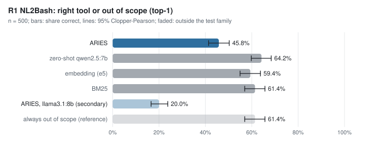
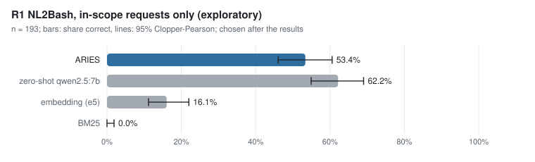
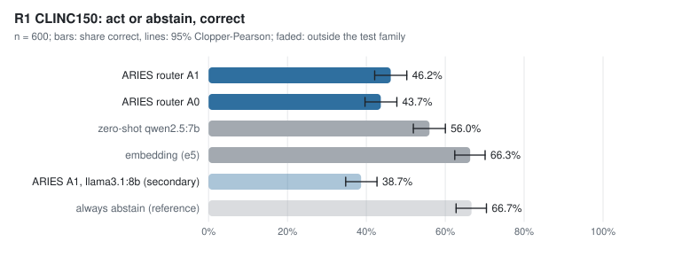
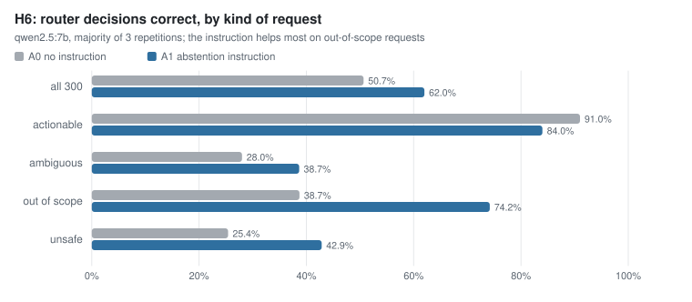
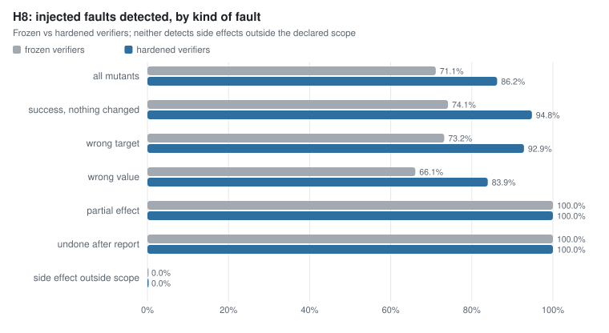
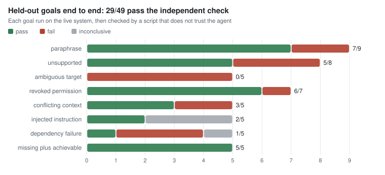

# Анализи и споредби (Analyses and comparisons)

Оваа страница ги прикажува сите главни резултати како графици: ARIES наспроти споредбата (baseline) за секое
мерење. Графиците ги црта [`make_figures.py`](make_figures.py) директно од фајловите со резултати во
складиштето, без рачно внесени бројки:

```
python experiments/analysis/make_figures.py          # ги црта графиците во figures/
python experiments/analysis/make_figures.py --check  # проверува дека нацртаните се совпаѓаат со изворите
```

Скриптата користи само стандардната Python библиотека: нема модел, сервис или мрежа. `make check` ја пушта и
проверката на табелите и проверката на графиците.

**Ознаки.** *Потврдно* значи пререгистрирана хипотеза, измерена како што е регистрирана. *Истражувачко* значи
анализа што не е регистрирана како тест. Сите интервали се 95%.

| Извор | Што содржи |
|---|---|
| [`thesis-tables/`](../thesis-followup-20261012/thesis-tables/) | табелите на дипломската (проверени со `check.py`) |
| [`thesis-r1-real-data/summary.json`](../thesis-r1-real-data/summary.json) | R1 тестовите на јавни податоци |
| [`iis/real-data/mind/results/`](../iis/real-data/mind/results/) | MIND-small |
| [`iis/real-data/locomo/results/`](../iis/real-data/locomo/results/) | LoCoMo |

---

## 1. Сите потврдни тестови на едно место


Секој ред е еден пререгистриран тест. Полната точка е ARIES (или новата верзија), празната е споредбата.

- **Зелено, ARIES е подобар:** H6 (инструкција за одбивање) и H8 (зајакнати верификатори).
- **Црвено, споредбата е подобра:** пет R1 тестови на јавни податоци. Embedding, BM25 и zero-shot моделот се
  подобри од ARIES на NL2Bash и CLINC150.
- **Сиво, нема значајна разлика:** H5 (completion contract), H4b (resolver за појаснување) и A1 наспроти A0 на
  CLINC150.

H4b, H5, H6 и H8 се едно Holm семејство. Шесте R1 тестови се посебно семејство.

## 2. Дипломска: агентот

### R1: избор на алатка на јавни податоци (NL2Bash)



ARIES (рутер + planner) ја избира точната алатка, или точно кажува „надвор од опсег“, на 229 од 500 барања.
Zero-shot qwen2.5:7b, без ништо од ARIES, е на 321 од 500. Барањето надвор од опсег е точен одговор на 307 од
500 барања, па и „секогаш надвор од опсег“ (бледо) е подобро од ARIES.



Само на барањата во опсегот (истражувачко, избрано по резултатите) разликата е помала: ARIES 103/193 наспроти
zero-shot 120/193. Embedding и BM25 скоро никогаш не избираат алатка, па таму се слаби.

**Зошто ARIES губи.** Рутерот дејствува на 449 од 500 барања, иако 307 се надвор од опсег. Од 449-те повици
на planner-от, 126 враќаат аргументи што не поминуваат валидација (најчесто полето `path`)
([`exploratory.json`](../thesis-r1-real-data/exploratory.json)).

### R1: дејствувај или одбиј (CLINC150)



Рутерот со инструкција за одбивање (A1) е точен на 277 од 600 барања, без неа (A0) на 262 од 600. Разликата не
е значајна (p = 0,28). Zero-shot моделот (336) и embedding-от (398) се подобри. Embedding-от одбива скоро сè, а
тоа е точно на 400 од 600 барања.

### H6: инструкцијата за одбивање помага (потврдено)



На 300 нови барања A1 одлучува точно на 186, а A0 на 152 (McNemar p = 1,0 × 10⁻⁶, по Holm 3,1 × 10⁻⁶).
Добивката е речиси целата кај барањата надвор од опсег (од 24/62 на 46/62). Цената е мала: кај извршливите
барања точноста паѓа од 91/100 на 84/100, бидејќи A1 понекогаш одбива без потреба.

### H8: зајакнатите верификатори откриваат повеќе грешки (потврдено)



Во ARIES се вметнати 218 намерни грешки (мутанти). Зајакнатите верификатори откриваат 188, замрзнатите 155
(p по Holm 4,7 × 10⁻¹⁰). Најголема е добивката кај „пријавува успех, а ништо не сменил“ (од 43/58 на 55/58).
Страничните ефекти надвор од декларираниот опсег не ги открива ниту една верзија (0/14). Истражувачкиот flag
`ARIES_VERIFY_SCOPE` открива 12 од тие 14 ([`RESULTS.md`](../thesis-followup-20261012/RESULTS.md)).

### H5 и H4b: не се потврдени

| Тест | Ново | Споредба | Резултат |
|---|---|---|---|
| H5, типизиран completion contract | 2/15 цели точно завршени | 0/15 | p = 0,25, не е значајно; лажните „завршено“ пораснаа од 3/75 на 12/75 |
| H4b, resolver за појаснување | 0/40 точни парови | 0/40 | со resolver-от ARIES прашува секогаш, без него никогаш |

### Од почеток до крај: held-out цели



29 од 49 цели што ARIES не ги видел поминуваат независна проверка. Најслаби се двосмислените цели (0/5) и
целите со пад на зависност (1/5). Ниту една цел не стигнала до состојба `done`. Причината е дијагностицирана
([`terminal-state-diagnosis.md`](../../docs/analysis/terminal-state-diagnosis.md)) и поправена зад flag, но
целите не се повторно измерени со поправката.

## 3. ИИС: информацискиот слој

### MIND: препорака на вести


Профилот на интереси на ARIES е подобар од сите baseline-и: AUC 0,613 наспроти 0,600 за embedding и 0,578 за
популарност. Разликата наспроти embedding-от е +0,013 [0,011, 0,016]. Учењето од кликови додава само +0,0001,
а разновидноста чини 0,035 AUC. Истражувачко мерење, не пререгистрирано
([детали](../iis/real-data/README.md)).

### LoCoMo: меморија од разговори


Обичното пребарување по зборови (BM25) го враќа вистинскиот дел од разговорот меѓу првите пет во 50,0% од
прашањата, а ARIES (e5) во 37,7%. По вид на прашање сликата е различна: ARIES е подобар кај multi-hop
прашањата (+0,106), сличен кај open-domain, а послаб кај temporal, single-hop и adversarial. Следниот чекор,
hybrid (BM25 + embedding), е измерен подоцна (M1, истражувачко): со `ARIES_MEMORY_HYBRID_RRF` и
`ARIES_MEMORY_SIMILARITY_RANK` hit@5 е 0,620, +0,120 [0,098; 0,147] над BM25 ([детали](../iis/real-data/README.md)).

## 4. Накратко

| Каде | Што покажува мерењето |
|---|---|
| Одбивање (H6) | ARIES со инструкција е подобар; потврдено |
| Верификација (H8) | зајакнатите верификатори се подобри; потврдено |
| Јавни податоци (R1) | ARIES е под едноставните baseline-и; рутерот одбива премалку, planner-от враќа неважечки аргументи |
| Завршување и појаснување (H5, H4b) | нема подобрување |
| Вести (MIND) | ARIES е подобар од baseline-ите; учењето не додава ништо |
| Меморија (LoCoMo) | BM25 е подобар во целина; ARIES е подобар на multi-hop |
